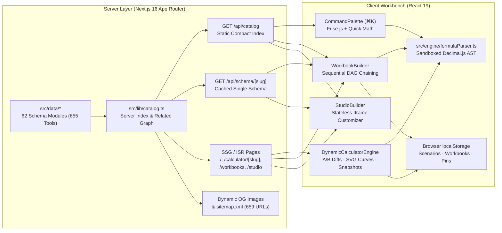

<div align="center">

<br />


# Quantify

**Deterministic, arbitrary-precision decision instruments, chained multi-step workbooks, and embeddable widgets.**

<p>
  <a href="https://quantify-ashen.vercel.app/">
    
  </a>
  
  
  
  
  
</p>

<p>
  <a href="https://quantify-ashen.vercel.app/"><strong>Live Workbench</strong></a>
  &nbsp;&middot;&nbsp;
  <a href="https://quantify-ashen.vercel.app/workbooks"><strong>Workbooks</strong></a>
  &nbsp;&middot;&nbsp;
  <a href="https://quantify-ashen.vercel.app/studio"><strong>Embed Studio</strong></a>
  &nbsp;&middot;&nbsp;
  <a href="https://quantify-ashen.vercel.app/methodology"><strong>Methodology</strong></a>
</p>

</div>

---

## Why Quantify

Most web calculators share three structural flaws: they evaluate formulas with IEEE-754 binary floats (introducing rounding drift across multi-decade financial models), hide their equations behind opaque black boxes, and trap every result in a single-page dead end.

Quantify replaces that model with a **declarative, local-first calculation workbench** across **655 instruments**:

- **Zero floating-point drift:** Every formula runs through a sandboxed recursive-descent AST evaluator backed by `decimal.js` (`src/engine/formulaParser.ts`)—with no `eval()` or dynamic code execution.
- **Inspectable math:** Click **Show the Math** on any instrument to audit every intermediate step, variable, and expression live.
- **Composable workflows:** Compare **Scenario A vs. B** with live deltas, plot interactive SVG projection curves, chain outputs across multiple calculators in **Workbooks**, or customize and embed any tool via **Embed Studio**.
- **Local-first privacy:** Saved snapshots, pinned tools, and chained workbooks stay in browser `localStorage` with portable JSON export/import and zero tracking cookies.

---

## Core Surfaces

| Surface | Route | What It Does |
| :--- | :--- | :--- |
| **Workbench** | `/` | Curated index of **655 instruments** organized into **5 Flagship Suites** + Explore Library, `⌘K` Command Palette with live `decimal.js` Quick Math, multi-currency formatting (`USD`, `EUR`, `GBP`, `THB`, `JPY`, `SGD`, `AUD`, `CAD`, `INR`), and a local **Saved Library** with JSON backup/restore. |
| **Instrument Engine** | `/calculator/[slug]` | Split-pane desktop workbench & sticky mobile readout dock with **A/B Scenario Compare**, 25-point interactive SVG sensitivity curves, **Show the Math** AST trace, named local snapshots, shareable `?a=...&b=...` links, and paper-optimized **Brief / PDF** print export. |
| **Workbooks** | `/workbooks` | Multi-calculator DAG canvas where Step `N` numeric inputs bind live to outputs from Steps `1..N-1` with exact scaling (`×1`, `×12`, `÷12`). Ships with 4 flagship decision templates, 647 chainable instruments, cycle-safe step reordering, local storage, and shareable `/workbooks?wb=...` URLs. |
| **Embed Studio** | `/studio` | Self-serve visual customizer for 647 schema-driven instruments: custom widget title, Light / Dark / Auto theme, brand hex accent, chart/compare/math toggles, validated `https://` CTA button, live Desktop/Mobile (`375px`) preview, and a stateless `<iframe>` snippet. |
| **Methodology** | `/methodology` | Transparent specification of the `decimal.js` AST engine, zero-cookie persistence, iframe security boundaries, and domain verification limits. |

---

## Instrument Coverage

Quantify organizes **655 unique instruments** (647 declarative JSON schemas + 7 bespoke interactive tools across 8 specialized routes) into five flagship suites and an extended library:

| Suite | Count | Focus Areas |
| :--- | :---: | :--- |
| **Wealth & Finance** | `110` | Mortgages, EMI, FIRE planning, compound growth, rent vs. buy, taxes, bonds, crypto |
| **Science, Math & Tech** | `85` | Symbolic CAS (`mathjs`), statistics, physics, chemistry dilutions, cloud & DevOps sizing |
| **Engineering & Energy** | `84` | Electrical circuits, structural loads, construction takeoffs, HVAC, solar payback |
| **Health & Clinical** | `79` | Lipid panels (Friedewald & Sampson 2020), progressive overload, metabolic & clinical baselines |
| **Business & Operations** | `67` | ROI, IRR/NPV, pricing margins, payroll allocation, freight & hospitality yield |
| **Explore Library** | `230` | Aviation, automotive, optics/photography, culinary scaling, sports, legal, productivity, unit conversions |

---

## Architecture

To keep individual calculator routes fast (`~50–65 KB` static HTML) despite shipping 655 schemas and guides (`~2.7 MB` raw data), the full schema registry stays strictly server-side. Client surfaces fetch compact metadata via static `/api/catalog` or resolve individual definitions on demand via `/api/schema/[slug]`.



### Declarative Schema Contract

Every schema-driven instrument conforms to `CalculatorSchema` (`src/types/calculator.ts`). Expressions support standard arithmetic (`+ - * / ^ %`), ternary conditionals (`cond ? a : b`), comparisons, scientific functions (`sqrt`, `ln`, `log`, `exp`, `sin`, `cos`, `min`, `max`, `round`, `pow`), and built-in financial helpers (`irr`, `npv`, `bond_price`, `macaulay_dur`, `annuity_fv`, `annuity_pv`):

```ts
const example: CalculatorSchema = {
  id: 'compound-interest',
  slug: 'compound-interest',
  title: 'Compound Interest Calculator',
  category: 'finance',
  inputs: [
    { id: 'principal', label: 'Initial Principal ($)', type: 'number', defaultValue: 10000 },
    { id: 'annualRate', label: 'Annual Interest Rate (%)', type: 'number', defaultValue: 7 },
    { id: 'compoundingFrequency', label: 'Compounds / Year', type: 'number', defaultValue: 12 },
    { id: 'years', label: 'Time Horizon (Years)', type: 'number', defaultValue: 10 },
  ],
  formulas: [
    { id: 'rate', expression: 'annualRate / 100', dependencies: ['annualRate'] },
    {
      id: 'amount',
      expression: 'principal * pow(1 + rate / compoundingFrequency, compoundingFrequency * years)',
      dependencies: ['principal', 'rate', 'compoundingFrequency', 'years'],
    },
    { id: 'interest', expression: 'amount - principal', dependencies: ['amount', 'principal'] },
  ],
  outputs: [
    { id: 'out_amount', label: 'Ending Balance', formulaRef: 'amount', format: 'currency', highlight: true },
    { id: 'out_interest', label: 'Total Interest Earned', formulaRef: 'interest', format: 'currency' },
  ],
};
```

---

## Design System (`design.md`)

Quantify implements a locked **Warm Precision Instrument** design contract in [design.md](design.md) and vanilla CSS ([src/app/globals.css](src/app/globals.css)):

- **Palette:** Perceptually uniform OKLCH tokens — *Warm Alabaster Paper* (Light) and *Deep Obsidian Walnut* (Dark) with muted architectural bronze accents.
- **Typography:** Self-hosted `Fraunces` (display), `IBM Plex Sans` (UI), and `IBM Plex Mono` with `font-variant-numeric: tabular-nums` on every readout and delta.
- **Iconography:** Unified `lucide-react` (`1.75px` stroke) across navigation, suites, and toolbars.
- **Responsive & Print:** Mobile-first breakpoints (`48rem` / `64rem`), `16px` minimum input sizing to prevent iOS zoom, sticky mobile readout dock, and dedicated `@media print` rules for clean 1-page Decision Briefs.

---

## Getting Started

**Prerequisites:** Node.js `>= 18.17` and npm `>= 9`.

```bash
git clone https://github.com/KhotJarb/quantify.git
cd quantify
npm install
cp .env.example .env.local
npm run dev
```

Open [http://localhost:3000](http://localhost:3000).

### Scripts

```bash
npm run dev     # Start local Next.js 16 Turbopack dev server
npm run lint    # Run ESLint (React 19 + Next.js 16 rules)
npm run build   # Type-check and build production bundle (SSG + API routes)
npm run start   # Serve compiled production build locally
```

---

## Environment Variables & Deployment

Quantify runs with **zero required environment variables** out of the box. Configure optional variables in `.env.local` or **Vercel → Settings → Environment Variables** (see [.env.example](.env.example)):

| Variable | Required | Purpose |
| :--- | :---: | :--- |
| `NEXT_PUBLIC_SITE_URL` | Optional | Canonical origin for `sitemap.xml`, `robots.txt`, JSON-LD, OG cards, and embed snippets (defaults to `https://quantify-ashen.vercel.app`). |
| `STUDIO_WEBHOOK_URL` | Optional | Discord, Slack, Make, Zapier, or JSON webhook URL for Studio early-access signups and high-signal telemetry (`embed_copy`, `studio_copy`, `workbook_share`, `demand_vote`, `demand_note`). Delivered reliably via Next.js `after()`. |
| `TELEMETRY_WEBHOOK_URL` | Optional | Optional separate webhook to forward all lightweight feature events (`compare_toggle`, `show_math_toggle`, `scenario_save`, etc.). |
| `RESEND_API_KEY` | Optional | Enables direct email alerts for Studio signups via [Resend](https://resend.com) (paired with `STUDIO_NOTIFY_EMAIL` and `STUDIO_FROM_EMAIL`). |
| `NEXT_PUBLIC_GOOGLE_SITE_VERIFICATION` | Optional | Injects Google Search Console `<meta name="google-site-verification">` automatically. |
| `NEXT_PUBLIC_BING_SITE_VERIFICATION` | Optional | Injects Bing Webmaster Tools `<meta name="msvalidate.01">` automatically. |

### HTTP Security & Embed Headers

Configured in [next.config.ts](next.config.ts):

- Global `X-Content-Type-Options: nosniff`, `Referrer-Policy: strict-origin-when-cross-origin`, and `Permissions-Policy`.
- `/calculator/:slug*` explicitly sends `Content-Security-Policy: frame-ancestors *` so Quantify Studio `<iframe>` widgets embed cleanly on third-party sites.
- `/workbooks`, `/studio`, and `/methodology` enforce `X-Frame-Options: SAMEORIGIN` and `Content-Security-Policy: frame-ancestors 'self'`.

---

## Project Structure

```text
quantify/
├── design.md                                  # Locked Warm Precision Instrument design contract
├── next.config.ts                             # Turbopack root & embed-safe security headers
├── .env.example                               # Optional deployment, webhook & verification vars
└── src/
    ├── app/
    │   ├── page.tsx                           # Server Component workbench entry
    │   ├── layout.tsx                         # Fonts, ThemeProvider, PreferencesProvider, Vercel Analytics
    │   ├── globals.css                        # Locked OKLCH tokens, responsive layout & print brief CSS
    │   ├── sitemap.ts / robots.ts             # Full 659-URL SEO indexation
    │   ├── opengraph-image.tsx                # Root 1200×630 OpenGraph card
    │   ├── workbooks/page.tsx                 # Chained multi-calculator Workbooks route
    │   ├── studio/page.tsx                    # Interactive Embed Studio route
    │   ├── methodology/page.tsx               # Engine, privacy & domain-scope documentation
    │   ├── calculator/[slug]/
    │   │   ├── page.tsx                       # SSG/ISR instrument route + generateMetadata + JSON-LD
    │   │   └── opengraph-image.tsx            # Per-calculator dynamic OG share card
    │   └── api/
    │       ├── catalog/route.ts               # Static compact catalog JSON (force-static)
    │       ├── schema/[slug]/route.ts         # Cached single CalculatorSchema lookup
    │       ├── studio-waitlist/route.ts       # Honeypot-protected waitlist capture (Webhook / Resend)
    │       └── telemetry/route.ts             # Privacy-safe event forwarding via Next.js after()
    ├── components/
    │   ├── calculator/                        # DynamicCalculatorEngine, ScenarioChart, EmbedModal,
    │   │                                      # DomainDisclaimer, DemandPulse + 7 lazy-loaded bespoke tools
    │   ├── dashboard/WorkbenchHome.tsx        # Flagship Suites, windowed catalog & Saved Scenarios library
    │   ├── layout/                            # AppShell (Precision Rail, mobile dock, colophon) & CommandPalette
    │   ├── workbooks/WorkbookBuilder.tsx      # Sequential Decimal.js DAG canvas & 4 flagship templates
    │   └── studio/StudioBuilder.tsx           # Live widget customizer & iframe generator
    ├── context/PreferencesContext.tsx         # useSyncExternalStore persistence (currency, pins, scenarios, recents)
    ├── data/                                  # 62 server-side calculator schema modules (655 instruments)
    ├── engine/formulaParser.ts                # Sandboxed recursive-descent Decimal.js AST parser
    ├── lib/                                   # Client-safe suite taxonomy, server catalog & telemetry helper
    └── types/calculator.ts                    # CalculatorSchema, Input, FormulaStep & Output contracts
```

---

## Verification & Domain Boundaries

Deterministic execution guarantees that every computed result matches the exact equation shown in **Show the Math** for the entered inputs. Domain-specific calculators (clinical/medical, financial/tax, structural/electrical engineering, and legal) are provided for exploratory modeling and educational planning—not as a replacement for licensed professional judgment. See [Methodology](https://quantify-ashen.vercel.app/methodology) for full details.

---

## License

Released under the [MIT License](LICENSE).
