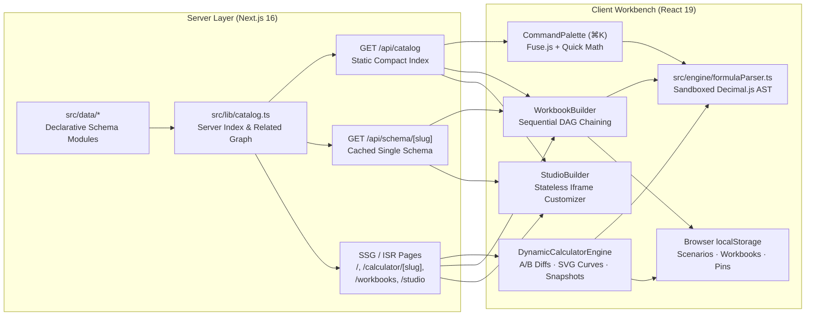

<div align="center">

<br />


# Quantify

**Free, ad-free calculators for finance, health, engineering, and everyday decisions — powered by exact decimal math.**

<p>
  
  
  
  
  
  
</p>

<br />

[](https://quantify-ashen.vercel.app/)

<br />

</div>

---

## Why Quantify

Most online calculators bury answers under ads, hide how results are computed, suffer from binary floating-point rounding drift, and force you to copy-paste numbers between tabs whenever one calculation feeds another.

Quantify is a calm, transparent, local-first calculation workbench built for real decisions:

- **Clear on every device:** Distraction-free Light and Dark themes with pinned live results on desktop and a sticky readout bar on mobile.
- **Exact decimal precision:** Formulas run on arbitrary-precision decimal arithmetic rather than standard JavaScript floats—no silent rounding drift on multi-decade projections.
- **Inspectable math:** Click **Show the Math** on any tool to audit every intermediate step and equation in real time.
- **Private by default:** No login walls, no ads, and no tracking cookies. Saved work stays in your browser unless you explicitly share a link.

---

## What You Can Do

- **Compare Options Side by Side (Scenario A vs. B):** Test two choices at once—such as a 15-year vs. 30-year mortgage or two return rates—and immediately see the exact numeric and percentage difference.
- **Explore Interactive Curves:** Visualize how results change over time or across selectable inputs; hover or drag along the chart to inspect any point.
- **Chain Calculators with Workbooks (`/workbooks`):** Link calculators in sequence so outputs from Step 1 automatically feed into Step 2 with live scaling (`×1`, `×12`, `÷12`)—including built-in templates like *Mortgage → FIRE Readiness*, *Compound Growth → FIRE Milestone*, *Solar Savings → Reinvestment*, and *Financing Cost → Required ROI*.
- **Embed Widgets with Studio (`/studio`):** Customize any formula calculator with your own title, theme, brand hex accent, feature toggles, and optional button, preview on desktop and mobile, and copy a single stateless `<iframe>` snippet.
- **Save, Share & Export:** Save named snapshots locally with JSON backup/restore, share pre-filled links, export clean 1-page PDF briefs, search or run quick math anywhere via `⌘K` / `Ctrl+K`, and switch currencies (`USD`, `EUR`, `GBP`, `THB`, `JPY`, `SGD`, `AUD`, `CAD`, `INR`).

---

## Included Suites

Calculators are organized into five core suites plus an extended library:

| Suite | Focus Areas |
| :--- | :--- |
| **Wealth & Finance** | Mortgages, loans, FIRE & retirement planning, compound growth, rent vs. buy, taxes, bonds, and crypto |
| **Health & Clinical** | Lipid panels (Friedewald & Sampson 2020), metabolic baselines, nutrition, body metrics, and strength progression |
| **Engineering & Energy** | Electrical circuits, structural loads, construction takeoffs, HVAC sizing, and solar payback |
| **Science, Math & Tech** | Symbolic CAS, scientific math, statistics, physics, chemistry dilutions, and cloud capacity sizing |
| **Business & Operations** | ROI, IRR/NPV, pricing margins, payroll allocation, freight volume, and unit economics |
| **Explore Library** | Aviation, automotive, optics & photography, culinary scaling, sports, legal, productivity, and unit conversions |

---

## Privacy & Responsible Use

- **Local-first storage:** Saved scenarios, pinned tools, workbooks, and preferences are stored locally in browser `localStorage`. Nothing leaves your device unless you explicitly generate and share a URL.
- **Domain scope:** Quantify guarantees that outputs match the equations shown in **Show the Math** for the inputs entered. Calculators in clinical/medical, financial/tax, legal, and engineering domains are intended for planning and exploration and do not replace advice from a licensed professional.

---

## Architecture & Tech Stack

| Layer | Technology | Role |
| :--- | :--- | :--- |
| **Framework** | Next.js 16 (App Router) | Server Components, SSG/ISR, per-route metadata, dynamic OG cards, sitemap |
| **UI Runtime** | React 19 + TypeScript 5 | Concurrent rendering, `useSyncExternalStore` persistence, strict typing |
| **Styling** | Vanilla CSS + OKLCH (`design.md`) | Mobile-first responsive system, tabular numerals, print-brief CSS |
| **Math Engine** | `decimal.js` + `mathjs` | Sandboxed recursive-descent AST evaluator (zero `eval()`) + lazy-loaded CAS |
| **Search & Icons** | `fuse.js` + `lucide-react` | Instant client fuzzy search via static catalog API + unified `1.75px` icons |
| **Theming** | `next-themes` | Flash-free Light / Dark mode switching |

To keep individual calculator routes lightweight despite a large declarative catalog, the full schema registry stays strictly server-side. Client features fetch compact metadata via `/api/catalog` or load individual schemas on demand via `/api/schema/[slug]`.



### Declarative Formula Contract

Schema-driven calculators implement `CalculatorSchema` (`src/types/calculator.ts`) and are evaluated step-by-step by `src/engine/formulaParser.ts` with arithmetic, conditionals, scientific functions, and built-in financial helpers (`irr`, `npv`, `bond_price`, `macaulay_dur`, `annuity_fv`, `annuity_pv`):

```ts
const example: CalculatorSchema = {
  id: 'compound-interest',
  slug: 'compound-interest',
  title: 'Compound Interest Calculator',
  category: 'finance',
  inputs: [
    { id: 'principal', label: 'Initial Principal ($)', type: 'number', defaultValue: 10000 },
    { id: 'annualRate', label: 'Annual Interest Rate (%)', type: 'number', defaultValue: 7 },
    { id: 'compoundingFrequency', label: 'Compounds / Year', type: 'number', defaultValue: 12 },
    { id: 'years', label: 'Time Horizon (Years)', type: 'number', defaultValue: 10 },
  ],
  formulas: [
    { id: 'rate', expression: 'annualRate / 100', dependencies: ['annualRate'] },
    {
      id: 'amount',
      expression: 'principal * pow(1 + rate / compoundingFrequency, compoundingFrequency * years)',
      dependencies: ['principal', 'rate', 'compoundingFrequency', 'years'],
    },
    { id: 'interest', expression: 'amount - principal', dependencies: ['amount', 'principal'] },
  ],
  outputs: [
    { id: 'out_amount', label: 'Ending Balance', formulaRef: 'amount', format: 'currency', highlight: true },
    { id: 'out_interest', label: 'Total Interest Earned', formulaRef: 'interest', format: 'currency' },
  ],
};
```

---

## Getting Started & Self-Hosting

**Prerequisites:** Node.js `>= 18.17` and npm `>= 9`.

```bash
git clone https://github.com/KhotJarb/quantify.git
cd quantify
npm install
cp .env.example .env.local
npm run dev
```

Open `http://localhost:3000` in your browser.

```bash
npm run dev     # Start local Next.js Turbopack dev server
npm run lint    # Run ESLint (React 19 + Next.js 16 rules)
npm run build   # Type-check and build production bundle
npm run start   # Serve compiled production build locally
```

### Optional Environment Variables

Quantify runs with **zero required environment variables**. Optional deployment variables are documented in `.env.example`:

| Variable | Purpose |
| :--- | :--- |
| `NEXT_PUBLIC_SITE_URL` | Canonical origin used for sitemaps, OG cards, metadata, and generated embed snippets. |
| `STUDIO_WEBHOOK_URL` | Discord, Slack, or JSON webhook URL for Studio early-access requests and high-signal events (delivered via Next.js `after()`). |
| `TELEMETRY_WEBHOOK_URL` | Optional separate webhook to forward lightweight feature telemetry events. |
| `RESEND_API_KEY` | Optional email alerts via Resend (paired with `STUDIO_NOTIFY_EMAIL` and `STUDIO_FROM_EMAIL`). |
| `NEXT_PUBLIC_GOOGLE_SITE_VERIFICATION` | Injects Google Search Console verification meta tag automatically. |
| `NEXT_PUBLIC_BING_SITE_VERIFICATION` | Injects Bing Webmaster Tools verification meta tag automatically. |

Security & embed headers are configured in `next.config.ts`: `/calculator/:slug*` allows third-party `<iframe>` embedding (`frame-ancestors *`), while app shell pages (`/workbooks`, `/studio`, `/methodology`) enforce `SAMEORIGIN` along with global `nosniff`, `Referrer-Policy`, and `Permissions-Policy` headers.

---

## Project Structure

```text
quantify/
├── design.md                                  # Warm Precision Instrument design contract
├── next.config.ts                             # Turbopack root & embed-safe security headers
├── .env.example                               # Optional deployment & webhook variables
└── src/
    ├── app/
    │   ├── page.tsx                           # Workbench home (Server Component)
    │   ├── layout.tsx                         # Fonts, ThemeProvider, PreferencesProvider, Analytics
    │   ├── globals.css                        # OKLCH tokens, responsive layout & print CSS
    │   ├── sitemap.ts / robots.ts             # SEO indexation
    │   ├── opengraph-image.tsx                # Root OpenGraph share card
    │   ├── workbooks/page.tsx                 # Chained multi-calculator Workbooks
    │   ├── studio/page.tsx                    # Interactive Embed Studio
    │   ├── methodology/page.tsx               # Engine, privacy & domain-scope spec
    │   ├── calculator/[slug]/                 # SSG/ISR instrument route + dynamic OG card
    │   └── api/                               # /catalog, /schema/[slug], /studio-waitlist, /telemetry
    ├── components/
    │   ├── calculator/                        # DynamicCalculatorEngine, ScenarioChart, EmbedModal & bespoke tools
    │   ├── dashboard/WorkbenchHome.tsx        # Suites, windowed catalog & Saved Scenarios library
    │   ├── layout/                            # AppShell (Precision Rail, mobile dock, colophon) & CommandPalette
    │   ├── workbooks/WorkbookBuilder.tsx      # Sequential Decimal.js DAG canvas & templates
    │   └── studio/StudioBuilder.tsx           # Live widget customizer & iframe generator
    ├── context/PreferencesContext.tsx         # Local persistence (currency, pins, scenarios, recents)
    ├── data/                                  # Server-side calculator schema modules
    ├── engine/formulaParser.ts                # Sandboxed recursive-descent Decimal.js AST parser
    ├── lib/                                   # Client-safe suite taxonomy, server catalog & telemetry helper
    └── types/calculator.ts                    # CalculatorSchema TypeScript contracts
```

---

## License

Released under the [MIT License](LICENSE).
